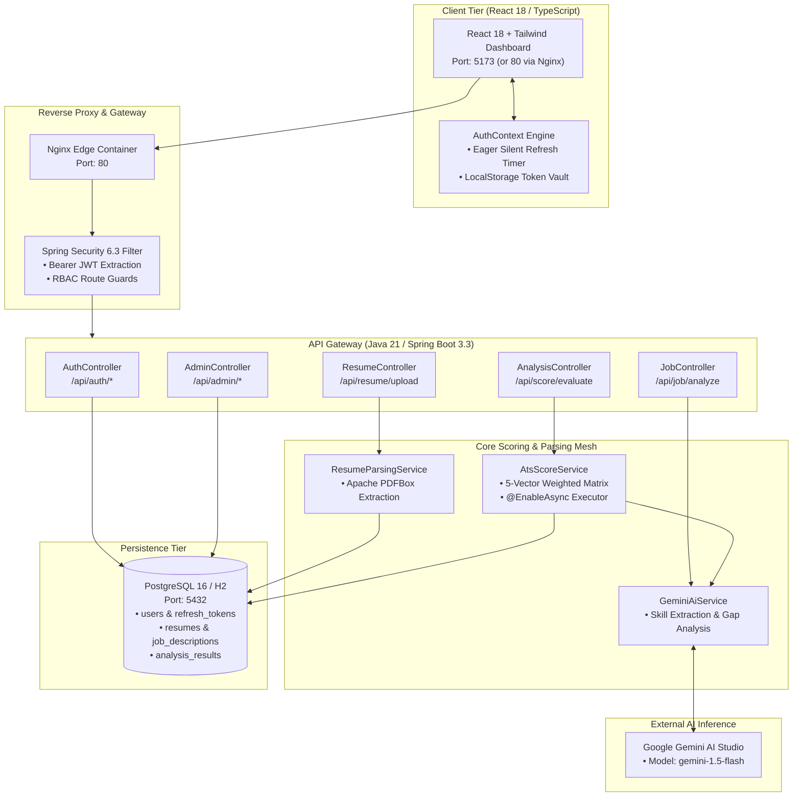

# ResumeIQ Platform

[](https://adoptium.net)
[](https://spring.io)
[](https://react.dev)
[](https://www.typescriptlang.org)
[](https://tailwindcss.com)
[](https://vite.dev)
[](https://www.postgresql.org)
[](https://www.docker.com)
[](https://deepmind.google/technologies/gemini/)
[](https://jwt.io)
[](LICENSE)

An enterprise-grade **SaaS ATS intelligence and resume optimization engine** pairing a reactive **Spring Boot 3.3 / Java 21 backend** with a refined **React 18 TypeScript dashboard**. Powered by **Google Gemini AI** and **Apache PDFBox**, the platform evaluates candidate resumes against complex job descriptions in real-time, executing multi-weighted scoring algorithms, skill gap analysis, eager refresh-token lifecycle management, and actionable career roadmap recommendations.

---

## Key Architecture Pillars

- **Asynchronous ATS Scoring Engine (`com.resumeiq.service.AtsScoreService`):**
  Non-blocking `@EnableAsync` analysis pipeline computing comprehensive 5-vector ATS compatibility scores ($S_{\text{total}} = \sum w_i \cdot s_i$) in under 3.5 seconds.
- **Dual-Stream Document Ingestion (`com.resumeiq.service.ResumeParsingService`):**
  Streamlined PDF ingestion powered by Apache PDFBox that cleans, normalizes, and extracts structured semantic resume sections without text corruption.
- **Gemini Skill Gap Attribution (`com.resumeiq.service.GeminiAiService`):**
  High-speed contextual inference via Google Gemini API extracting job description competencies and categorizing candidate deficits into missing critical skills and weak keywords.
- **Eager Refresh Token Security Architecture (`com.resumeiq.security`):**
  Dual-token system featuring short-lived access JWTs and database-persisted UUID refresh tokens (`RefreshToken`), paired with client-side eager auto-renewal 10 seconds before expiration.
- **Role-Based Clearance Matrix (`com.resumeiq.config.SecurityConfig`):**
  Four-tier authorization hierarchy separating `JOB_SEEKER`, `RECRUITER`, `ENTERPRISE`, and `ADMIN` personas with built-in seeder routines.

---

## System Architecture



---

## ATS Scoring Weighted Matrix & Invariants

The engine calculates objective candidate suitability across five weighted dimensions:

$$S_{\text{overall}} = 0.45 \cdot S_{\text{skill}} + 0.20 \cdot S_{\text{exp}} + 0.15 \cdot S_{\text{keywords}} + 0.10 \cdot S_{\text{struct}} + 0.10 \cdot S_{\text{ai}}$$

| Assessment Dimension | Weight ($w_i$) | Evaluation Criteria | Optimization Recommendation |
| :--- | :---: | :--- | :--- |
| **Skill Match** | `45%` | Direct overlap with job mandatory requirements | Identify missing technical tooling & frameworks |
| **Experience Relevance** | `20%` | Alignment of past roles, seniority, and responsibilities | Reorder achievements toward job scope |
| **Keyword Density** | `15%` | Frequency and context of core domain terminology | Inject industry keywords without keyword-stuffing |
| **Resume Formatting** | `10%` | Section headers, typography, parse readability | Fix non-standard headers, tables, or columns |
| **AI Fit Confidence** | `10%` | LLM holistic semantic reasoning score | Strengthen project narrative and deliverables |

---

## Quickstart & Platform Orchestration

### Prerequisites
- Docker Desktop (with Compose v2+)
- Java 21 LTS & Maven 3.9+
- Node.js 20+ & npm
- Google AI Studio API Key ([Get API Key](https://aistudio.google.com/app/apikey))

---

### Option A: Automated Docker Compose Orchestration (Recommended)

Launch the full-stack containerized platform (PostgreSQL 16, Spring Boot API, and Nginx-powered React dashboard) in one command:
```bash
# Clone repository
git clone https://github.com/i-viki/resumeiq-ai-platform.git
cd resumeiq-ai-platform

# Configure environment variables
cp .env.example .env
# Edit .env with your GEMINI_API_KEY and passwords

# Launch containers
docker compose up --build -d
```
*Platform active at `http://localhost` (Frontend: `:80`, Backend: `:8080`, PostgreSQL: `:5432`).*

To cleanly shut down all services:
```bash
docker compose down -v
```

---

### Option B: Step-by-Step Manual Launch

#### Step 1: Launch Backend with In-Memory H2 (Dev Profile)
```bash
cd backend
export GEMINI_API_KEY="your-gemini-api-key"
./mvnw spring-boot:run
# Windows: .\mvnw.cmd spring-boot:run
```
*Backend initializes on `http://localhost:8080` with embedded H2 database.*

#### Step 2: Launch Frontend Development Server
```bash
cd frontend
npm install
npm run dev
# Dashboard active at: http://localhost:5173
```

---

## Decoupled Environment Strategy

All services extract hostnames, database connection strings, and AI credentials into decoupled environment templates:

| Service / Layer | Config File | Template Reference | Key Variables |
| :--- | :--- | :--- | :--- |
| **Frontend UI** | `frontend/vite.config.ts` | [`frontend/.env.example`](frontend/.env.example) | `VITE_API_BASE_URL` (Defaults to `/api`) |
| **Backend Core** | `backend/src/main/resources/application.yml` | [`.env.example`](.env.example) | `SPRING_PROFILES_ACTIVE`, `GEMINI_API_KEY`, `JWT_SECRET` |
| **Production Store**| `application.yml` | [`.env.example`](.env.example) | `DATABASE_URL`, `DATABASE_USERNAME`, `DATABASE_PASSWORD` |
| **Docker Compose** | `docker-compose.yml` | [`.env.example`](.env.example) | Port allocations and inter-container bridges |

---

## Live Telemetry & Observability Hubs

| Hub / Service | Port | URL | Role & Live Features |
| :--- | :--- | :--- | :--- |
| **React ATS Dashboard** | `5173` | [http://localhost:5173](http://localhost:5173) | Interactive ATS Workspace, resume upload studio & admin panel. |
| **Backend REST API** | `8080` | [http://localhost:8080/actuator/health](http://localhost:8080/actuator/health) | Analysis pipeline status and database connectivity health. |
| **H2 Database Console** | `8080` | [http://localhost:8080/h2-console](http://localhost:8080/h2-console) | In-memory relational explorer (active under `dev` profile). |

---

## Testing & Quality Assurance Suite

### Backend Service Tests (Java 21)
```bash
cd backend
./mvnw test
# Validates JWT parsing, PDFBox extraction, and ATS scoring formulas.
```

### Async ATS Evaluation Request
```bash
curl -X POST http://localhost:8080/api/score/evaluate \
  -H "Content-Type: application/json" \
  -H "Authorization: Bearer <JWT_TOKEN>" \
  -d '{
    "resumeId": 1,
    "jobDescriptionId": 1
  }'
```

### Direct Resume PDF Upload
```bash
curl -X POST http://localhost:8080/api/resume/upload \
  -H "Authorization: Bearer <JWT_TOKEN>" \
  -F "file=@/path/to/resume.pdf"
```

---

## Author

**Jayavignesh**
- **Website:** [jayavignesh.dev](https://jayavignesh.dev)
- **GitHub:** [@i-viki](https://github.com/i-viki)
- **Email:** [hello@jayavignesh.dev](mailto:hello@jayavignesh.dev)

---

## License

This platform is distributed under the **MIT License**. See the [`LICENSE`](LICENSE) file for complete terms.
